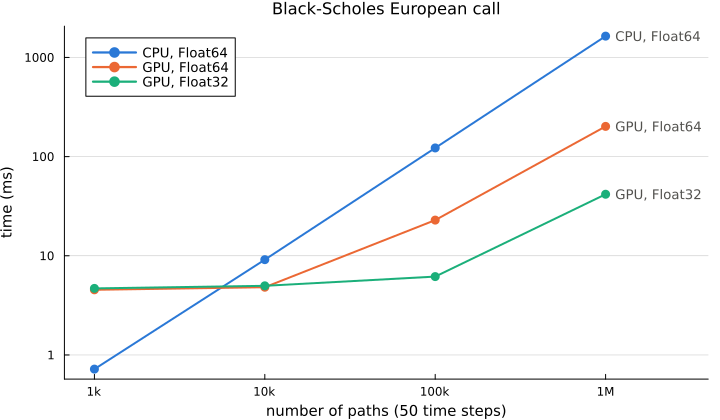

# Performance

## CPU or GPU

With CUDA.jl loaded, `CudaMode` runs the simulation on the GPU, and the code is the same as on the
CPU (see [Monte Carlo configuration](@ref)). Whether it pays depends on the number of paths: every
time step launches a kernel, so below about ten thousand paths the launches cost more than the
computation, and above it the GPU wins by an increasing margin. Single precision helps much more
on a GPU than on a CPU, because consumer GPUs have few double precision units.

Price of a European call under Black-Scholes with 50 time steps, minimum time in milliseconds:

| Paths | CPU, `Float64` | GPU, `Float64` | GPU, `Float32` |
|--:|--:|--:|--:|
| 1 000 | 0.72 | 4.54 | 4.69 |
| 10 000 | 9.14 | 4.82 | 4.98 |
| 100 000 | 122.32 | 22.90 | 6.17 |
| 1 000 000 | 1640.16 | 201.76 | 41.74 |

Measured on an Intel Core i7-8550U (one thread) and an NVIDIA GeForce MX150, with Julia 1.13 and
BenchmarkTools, synchronizing the GPU with `CUDA.@sync` (kernels are asynchronous, so without it
the time stops at the launch). The script is `docs/performance/scaling.jl`; it needs a GPU, so the
figure is not regenerated when the documentation is built.

Beyond the diffusion, three steps of some models and payoffs could go through the host. In
`CudaMode` they stay on the GPU or move only what they need:

- the gamma and inverse Gaussian subordinators of variance gamma and normal inverse Gaussian are
  drawn on the GPU (other laws of a `SubordinatedBrownianMotion` are drawn on the host and copied);
- the jumps of Kou and Merton are drawn on the host as a list of times and sizes, and one kernel
  adds them to the paths;
- barrier and Asian payoffs are reductions of the paths (minimum, maximum, mean) on the GPU;
  American and Bermudan payoffs, whose Longstaff-Schwartz regressions run on the host, still copy
  the paths there.

100 000 paths × 50 steps, median time and host memory, before (0.6.0) and after these changes:

| Case | 0.6.0 | now | host memory, 0.6.0 → now |
|:--|--:|--:|--:|
| Black-Scholes, European | 27.9 ms | 24.8 ms | 59 KiB → 59 KiB |
| Kou, European | 75.3 ms | 39.4 ms | 39 MiB → 10 MiB |
| Merton, European | 74.4 ms | 36.3 ms | 39 MiB → 10 MiB |
| Variance gamma, European | 236 ms | 131 ms | 851 KiB → 86 KiB |
| Normal inverse Gaussian, European | 194 ms | 64 ms | 851 KiB → 86 KiB |
| Black-Scholes, barrier (down and out) | 73.8 ms | 26.3 ms | 79 MiB → 64 KiB |
| Black-Scholes, Asian (fixed strike) | 74.1 ms | 27.3 ms | 79 MiB → 65 KiB |

Measured on the same NVIDIA GeForce MX150 with BenchmarkTools and `CUDA.@sync`; the Black-Scholes
European case, whose code did not change, shows the noise between runs (about 10%).

## Getting the most out of a run

- Price several payoffs on the same paths: a vector of payoffs, a [`FinancialMonteCarlo.Position`](@ref)
  or a smile simulate once. A smile on the GPU computes all its strikes in one kernel and keeps the
  prices there, so further work on them, such as implied volatilities, needs no transfer.
- European payoffs need a single time step: the number of steps only matters for path dependent
  payoffs, early exercise and models without an exact one step scheme.
- Antithetic variates halve the normal draws and usually the variance too, at no extra cost.
- Constant rates are cheaper than curves, whose drift is integrated at every step.
- On the CPU, `MultiThreading` splits the paths into batches priced on different threads; the
  results do not depend on the number of threads. The paths of all the steps are stored, so the
  simulation is bound by memory traffic: 4 threads price 40 000 paths × 50 steps 2.8 times faster
  than one.
- For gradients, ForwardDiff is the fastest backend up to a few dozen parameters, Enzyme in
  reverse mode (or Mooncake) above; ReverseDiff is about a hundred times slower, see
  [Automatic differentiation](@ref autodiff).
- Keep the numeric type uniform: `Float32` inputs give `Float32` paths and prices, and a single
  `Float64` input promotes the whole computation.
